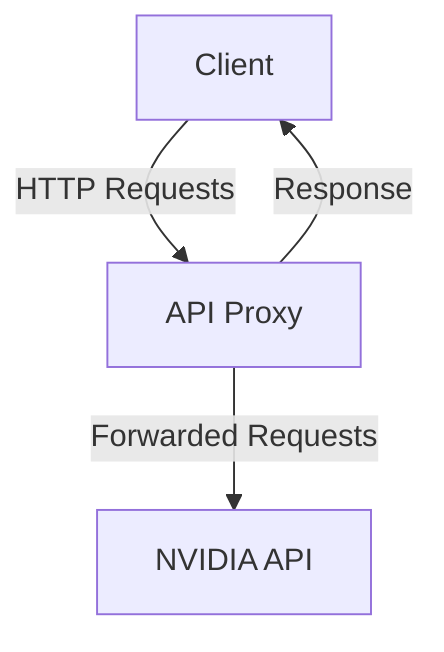
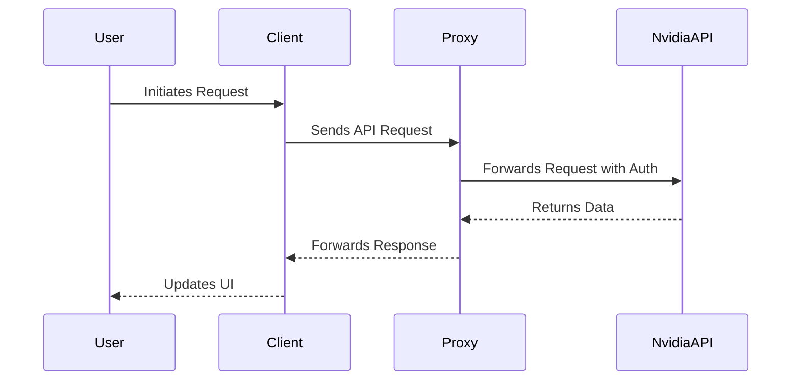
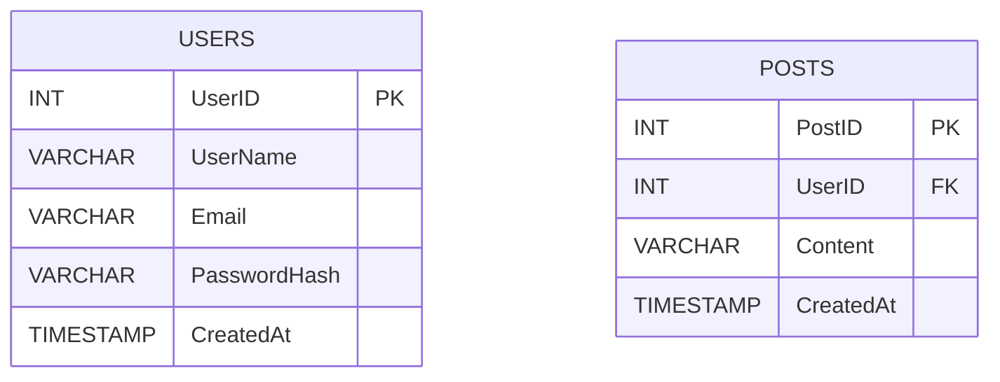
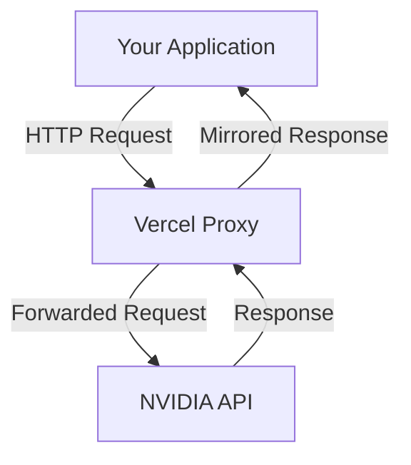
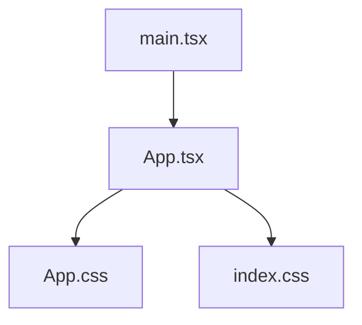
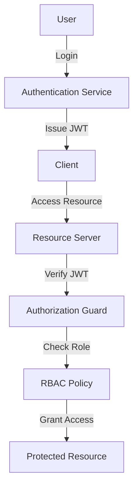

# docpoc.git — Enterprise Documentation

> **Enterprise-Grade Documentation Workspace** generated across 20 source files.

## Table of Contents

1. [Executive Summary & System Overview](#overview)
2. [System Architecture & Component Design](#architecture)
3. [Database Architecture & Entity Models](#database-models)
4. [API Endpoints & Integration Reference](#api-reference)
5. [Subsystem: Api](#module-api)
6. [Subsystem: Src](#module-src)
7. [Authentication, Security & Workflow Engine](#security-workflows)
8. [Deployment, Operations & Infrastructure](#deployment-operations)
9. [Developer Setup, Testing & Engineering Standards](#developer-guide)

---

<a id="overview"></a>

# Executive Summary & System Overview

## Project Mission
The `docpoc.git` repository serves as a Proof of Concept (PoC) for a modern web application built using React, TypeScript, and Vite. The primary objective is to demonstrate a streamlined development setup that leverages cutting-edge tools and libraries to ensure high performance, maintainability, and developer productivity. This project is designed to be a template for enterprise-grade applications, providing a robust foundation for further customization and scaling.

## Repository Directory Map
The repository is structured to facilitate modular development and ease of navigation. Below is a high-level overview of the directory structure:

```
docpoc.git/
├── README.md
├── package.json
├── tsconfig.json
├── tsconfig.node.json
├── tsconfig.app.json
├── vite.config.ts
├── src/
│   ├── components/
│   ├── pages/
│   ├── App.tsx
│   ├── main.tsx
│   ├── styles/
│   └── utils/
├── public/
└── dist/
```

## Core Technology Stack
The project leverages a modern technology stack to ensure optimal performance and developer experience:

### Frontend Framework
- **React**: A JavaScript library for building user interfaces, enabling component-based architecture and efficient rendering.
- **TypeScript**: A typed superset of JavaScript that enhances code quality and developer productivity through static type checking.

### Build Tool
- **Vite**: A next-generation frontend tooling that offers fast development server start-up and optimized production builds.

### Styling
- **Tailwind CSS**: A utility-first CSS framework for rapidly building custom user interfaces.
- **PostCSS**: A tool for transforming CSS with JavaScript, enabling advanced CSS features and optimizations.

### Linting & Code Quality
- **ESLint**: A pluggable linting utility for JavaScript and TypeScript, ensuring code consistency and identifying potential issues.
- **TypeScript ESLint**: Enhances ESLint with TypeScript-specific linting rules.

### Additional Libraries
- **Lucide React**: A collection of customizable icons for React applications.
- **React Markdown**: A component for rendering Markdown content in React.

## Key Features
- **Hot Module Replacement (HMR)**: Enables instant updates to the application during development without a full reload.
- **Type-Aware Linting**: Ensures type safety and consistency across the codebase.
- **Optimized Build Process**: Utilizes Vite's build optimizations for fast production builds.

## Configuration Highlights

### ESLint Configuration
The project includes a comprehensive ESLint configuration to enforce code quality and consistency:

```js
// eslint.config.js
import reactX from 'eslint-plugin-react-x'
import reactDom from 'eslint-plugin-react-dom'

export default defineConfig([
  globalIgnores(['dist']),
  {
    files: ['**/*.{ts,tsx}'],
    extends: [
      tseslint.configs.recommendedTypeChecked,
      tseslint.configs.strictTypeChecked,
      tseslint.configs.stylisticTypeChecked,
      reactX.configs['recommended-typescript'],
      reactDom.configs.recommended,
    ],
    languageOptions: {
      parserOptions: {
        project: ['./tsconfig.node.json', './tsconfig.app.json'],
        tsconfigRootDir: import.meta.dirname,
      },
    },
  },
])
```

### Vite Configuration
The Vite configuration is optimized for React and TypeScript:

```js
// vite.config.ts
import { defineConfig } from 'vite'
import react from '@vitejs/plugin-react'

export default defineConfig({
  plugins: [react()],
  build: {
    outDir: 'dist',
  },
})
```

## Development Workflow

### Running the Development Server
To start the development server with hot module replacement:

```bash
npm run dev
```

### Building for Production
To build the application for production:

```bash
npm run build
```

### Linting the Codebase
To lint the entire codebase:

```bash
npm run lint
```

### Previewing the Production Build
To preview the production build locally:

```bash
npm run preview
```

## Conclusion
The `docpoc.git` repository provides a robust foundation for building modern web applications using React, TypeScript, and Vite. With a focus on performance, maintainability, and developer productivity, this template is well-suited for enterprise-grade projects. The comprehensive ESLint and Vite configurations ensure code quality and optimized builds, while the modular directory structure facilitates scalable development.

---

<a id="architecture"></a>

# System Architecture & Component Design

Welcome to the comprehensive documentation for the `docpoc.git` repository. This document provides an in-depth overview of the system architecture, component design, and data flow within the project. It is intended for developers and architects who are involved in the maintenance and extension of this project.

## Table of Contents

1. [Overview](#overview)
2. [Architecture](#architecture)
3. [Component Design](#component-design)
4. [Data Flow](#data-flow)
5. [Configuration and Environment](#configuration-and-environment)
6. [Code Examples](#code-examples)

## Overview

The `docpoc.git` project is a React application built with TypeScript and Vite. It leverages modern JavaScript tooling and libraries to provide a robust development environment. The application is designed to be a document assistant, utilizing a proxy to interact with external APIs.

## Architecture

The architecture of the `docpoc.git` project follows a client-server model with a focus on modularity and scalability. The application is structured to separate concerns effectively, ensuring that each component and module has a clear responsibility.

### High-Level Architecture Diagram



- **Client**: The front-end application built with React and TypeScript.
- **API Proxy**: A server-side component that forwards requests to the NVIDIA API, adding necessary authentication headers.
- **NVIDIA API**: An external service that the application interacts with to fetch data.

## Component Design

The application is composed of several key components, each responsible for a specific part of the functionality:

### Frontend Components

- **React Components**: Built using functional components and hooks, ensuring a clean and maintainable codebase.
- **Vite**: Used for bundling and development server, providing fast HMR (Hot Module Replacement).

### Backend Components

- **API Proxy**: Located in the `api` directory, this component handles all requests to the NVIDIA API. It ensures that requests are authenticated and responses are correctly forwarded back to the client.

#### API Proxy Handler

The proxy handler is implemented in JavaScript and is responsible for forwarding requests to the NVIDIA API. Below is a simplified version of the handler:

```javascript
export default async function handler(req, res) {
  const targetPath = req.url.replace(/^\/api\/nvidia-proxy/, '');
  const targetUrl = `https://integrate.api.nvidia.com${targetPath}`;

  const response = await fetch(targetUrl, {
    method: req.method,
    headers: {
      ...req.headers,
      Authorization: `Bearer ${process.env.NVIDIA_API_KEY}`,
      'Content-Type': 'application/json',
      Accept: 'text/event-stream',
    },
    body: req.method !== 'GET' && req.method !== 'HEAD' ? JSON.stringify(req.body) : undefined,
  });

  const data = await response.text();
  res.setHeader('Content-Type', response.headers.get('content-type') || 'application/json');
  res.status(response.status).send(data);
}
```

## Data Flow

The data flow within the application is straightforward, focusing on efficient data retrieval and rendering:

1. **User Interaction**: The user interacts with the React front-end.
2. **API Request**: The front-end sends a request to the API Proxy.
3. **Proxy Forwarding**: The API Proxy forwards the request to the NVIDIA API, adding necessary headers.
4. **Data Retrieval**: The NVIDIA API processes the request and returns data.
5. **Response Handling**: The API Proxy receives the response and forwards it back to the client.
6. **UI Update**: The front-end updates the UI based on the received data.

### Data Flow Diagram



## Configuration and Environment

The project uses environment variables to manage sensitive information such as API keys. The `NVIDIA_API_KEY` is expected to be set as an environment variable in the deployment environment.

### Example Configuration

```bash
# .env
NVIDIA_API_KEY=your_api_key_here
```

## Code Examples

### cURL Request Example

To test the API proxy, you can use the following cURL command:

```bash
curl -X GET "http://localhost:3000/api/nvidia-proxy/your-endpoint" \
     -H "Authorization: Bearer your_api_key_here"
```

### ESLint Configuration

The project uses ESLint for code quality and consistency. Below is an example configuration for TypeScript and React:

```javascript
import reactX from 'eslint-plugin-react-x'
import reactDom from 'eslint-plugin-react-dom'

export default defineConfig([
  globalIgnores(['dist']),
  {
    files: ['**/*.{ts,tsx}'],
    extends: [
      reactX.configs['recommended-typescript'],
      reactDom.configs.recommended,
    ],
    languageOptions: {
      parserOptions: {
        project: ['./tsconfig.node.json', './tsconfig.app.json'],
        tsconfigRootDir: import.meta.dirname,
      },
    },
  },
])
```

## Conclusion

This documentation provides a detailed overview of the `docpoc.git` system architecture and component design. By understanding the architecture and data flow, developers can effectively maintain and extend the application. For further questions or contributions, please refer to the project's README or contact the development team.

---

<a id="database-models"></a>

# Database Architecture & Entity Models

Welcome to the comprehensive documentation for the "docpoc.git" repository's database architecture and entity models. This document aims to provide an in-depth understanding of the relational entity models, schema definitions, table attributes, keys, constraints, and data lifecycles within the project.

## Overview

The "docpoc.git" repository is primarily a React application using TypeScript and Vite for development. Based on the current repository files, there is no explicit database schema or SQL models detected. This suggests that the application may rely on external APIs or services for data management, or it may be in the early stages of development where database integration has not yet been implemented.

## Database Context

### Current State

- **Database Models**: No dedicated database models or SQL schemas detected.
- **Endpoints**: No endpoints detected within the repository files.
- **Infrastructure**: Standard application runtime; no container or deployment orchestration manifests detected.

### Implications

Given the absence of database models, it is likely that the application either:
- Uses external APIs for data handling, as evidenced by the proxy setup for NVIDIA API integration.
- Is in a phase where database integration is planned but not yet implemented.

## Proxy API Integration

The repository includes a proxy setup for interacting with the NVIDIA API. This proxy is implemented in several files within the `api` directory. Below is a brief overview of the proxy setup:

### Proxy Handler Example

```javascript
export default async function handler(req, res) {
  const targetPath = req.url.replace(/^\/api\/nvidia-proxy/, '');
  const targetUrl = `https://integrate.api.nvidia.com${targetPath}`;

  const response = await fetch(targetUrl, {
    method: req.method,
    headers: {
      ...req.headers,
      Authorization: `Bearer ${process.env.NVIDIA_API_KEY}`,
      'Content-Type': 'application/json',
      Accept: 'text/event-stream',
    },
    body: req.method !== 'GET' && req.method !== 'HEAD' ? JSON.stringify(req.body) : undefined,
  });

  const data = await response.text();
  res.setHeader('Content-Type', response.headers.get('content-type') || 'application/json');
  res.status(response.status).send(data);
}
```

### Configuration

Ensure that the `NVIDIA_API_KEY` environment variable is set in your deployment environment to authorize requests to the NVIDIA API.

## Future Database Integration

### Recommendations

1. **Define Database Models**: As the project evolves, consider defining explicit database models using an ORM (Object-Relational Mapping) tool such as Sequelize or TypeORM for Node.js applications. This will facilitate easier data management and integration.

2. **Schema Design**: Design relational schemas that reflect the application's data requirements. Consider the following components:
   - **Tables**: Define tables for each entity with appropriate attributes.
   - **Keys**: Establish primary and foreign keys to maintain data integrity.
   - **Constraints**: Implement constraints to enforce data validation rules.

3. **Data Lifecycle Management**: Plan for data lifecycle management, including data creation, update, retrieval, and deletion processes.

### Example Schema Definition

Below is an example of how a simple user table might be defined using SQL:

```sql
CREATE TABLE Users (
    UserID INT PRIMARY KEY,
    UserName VARCHAR(255) NOT NULL,
    Email VARCHAR(255) UNIQUE NOT NULL,
    PasswordHash VARCHAR(255) NOT NULL,
    CreatedAt TIMESTAMP DEFAULT CURRENT_TIMESTAMP
);
```

### Mermaid Diagram

To visualize a potential database schema, consider the following Mermaid diagram:



## Conclusion

This documentation provides a foundational understanding of the current state of the "docpoc.git" repository concerning database architecture and entity models. As the project progresses, integrating a robust database schema will be crucial for managing data effectively and ensuring scalability.

For further development, consider leveraging modern database technologies and practices to enhance the application's data handling capabilities.

---

<a id="api-reference"></a>

# API Endpoints & Integration Reference

Welcome to the comprehensive API Endpoints & Integration Reference for the `docpoc.git` repository. This document serves as a detailed guide for developers looking to integrate with the NVIDIA API through our Vercel proxy setup. It includes endpoint specifications, request and response schemas, error handling, and practical examples to facilitate seamless integration.

## Overview

The `docpoc.git` repository provides a proxy service to interact with the NVIDIA API. This proxy is designed to forward requests from your application to the NVIDIA API, injecting necessary authentication headers and handling responses appropriately.

### Key Features

- **Proxy Service**: Forward requests to the NVIDIA API.
- **Authentication**: Automatically injects the `Authorization` header using a Vercel environment variable.
- **Flexible Path Handling**: Supports dynamic path resolution for API requests.

## API Endpoints

### Base URL

All API requests are made to the following base URL:

```
https://your-vercel-deployment-url/api/nvidia-proxy
```

### Endpoint Structure

The proxy service supports dynamic path resolution, allowing you to append any NVIDIA API path to the base URL. The proxy will forward the request to the corresponding NVIDIA API endpoint.

#### Example Endpoint

```
GET /api/nvidia-proxy/v1/resource
```

This request will be forwarded to:

```
https://integrate.api.nvidia.com/v1/resource
```

### Request Headers

- **Authorization**: Automatically injected by the proxy using the `NVIDIA_API_KEY` environment variable.
- **Content-Type**: `application/json`
- **Accept**: `text/event-stream`

### Request Methods

The proxy supports all standard HTTP methods, including `GET`, `POST`, `PUT`, `DELETE`, etc.

### Request Body

For `POST`, `PUT`, and other methods that require a body, the proxy will forward the JSON-encoded request body to the NVIDIA API.

## Integration Guide

### Environment Setup

Ensure that the `NVIDIA_API_KEY` environment variable is set in your Vercel deployment. This key is used to authenticate requests to the NVIDIA API.

### Example cURL Request

Below is an example of how to make a request to the proxy using cURL:

```bash
curl -X GET "https://your-vercel-deployment-url/api/nvidia-proxy/v1/resource" \
     -H "Content-Type: application/json" \
     -H "Accept: text/event-stream"
```

### Node.js Example

Here's how you can make a request using Node.js and the `axios` library:

```javascript
const axios = require('axios');

async function fetchData() {
  try {
    const response = await axios.get('https://your-vercel-deployment-url/api/nvidia-proxy/v1/resource', {
      headers: {
        'Content-Type': 'application/json',
        'Accept': 'text/event-stream'
      }
    });
    console.log(response.data);
  } catch (error) {
    console.error('Error fetching data:', error);
  }
}

fetchData();
```

## Error Handling

The proxy will mirror the response status and body from the NVIDIA API. Common HTTP status codes include:

- **200 OK**: Request succeeded.
- **400 Bad Request**: The request could not be understood or was missing required parameters.
- **401 Unauthorized**: Authentication failed or user does not have permissions for the requested operation.
- **404 Not Found**: The requested resource could not be found.
- **500 Internal Server Error**: An error occurred on the server.

## Architecture Diagram

Below is a high-level architecture diagram illustrating the data flow between your application, the proxy, and the NVIDIA API.



## Conclusion

This documentation provides a comprehensive guide to integrating with the NVIDIA API through the `docpoc.git` proxy service. By following the guidelines and examples provided, developers can efficiently leverage the NVIDIA API's capabilities within their applications. For further assistance, please refer to the NVIDIA API documentation or contact support.

---

<a id="module-api"></a>

# Subsystem: Api

## Overview

The `Api` subsystem in the `docpoc.git` repository is designed to act as a proxy for forwarding requests to the NVIDIA API. This subsystem is implemented using serverless functions, which are typically deployed on platforms like Vercel. The primary responsibility of this subsystem is to handle incoming HTTP requests, append necessary authorization headers, and forward them to the NVIDIA API, then return the response back to the client.

## Responsibilities

- **Proxy Requests**: Forward incoming requests to the NVIDIA API.
- **Authorization Handling**: Inject the necessary `Authorization` header using an API key stored in environment variables.
- **Response Handling**: Mirror the response from the NVIDIA API back to the client, preserving the status and content type.

## Source Files

The `Api` subsystem consists of three source files:

1. `api/nvidia-proxy.js`
2. `api/nvidia-proxy/[...path].js`
3. `api/nvidia-proxy/[[...path]].js`

Each file serves as a handler for different routing scenarios, allowing flexible URL path handling.

## Detailed File Descriptions

### 1. `api/nvidia-proxy.js`

This file handles requests to the root of the `/api/nvidia-proxy` endpoint. It constructs the target URL by appending the path after `/api/nvidia-proxy` to the base NVIDIA API URL.

#### Key Functionality

- **Target URL Construction**: Strips the `/api/nvidia-proxy` prefix and appends the remaining path to `https://integrate.api.nvidia.com`.
- **Request Forwarding**: Uses the `fetch` API to forward the request, including the method, headers, and body.
- **Authorization**: Injects the `Authorization` header using the `NVIDIA_API_KEY` environment variable.
- **Response Handling**: Sends the response back to the client with the appropriate content type and status.

#### Code Example

```javascript
export default async function handler(req, res) {
  const targetPath = req.url.replace(/^\/api\/nvidia-proxy/, '');
  const targetUrl = `https://integrate.api.nvidia.com${targetPath}`;

  const response = await fetch(targetUrl, {
    method: req.method,
    headers: {
      ...req.headers,
      Authorization: `Bearer ${process.env.NVIDIA_API_KEY}`,
      'Content-Type': 'application/json',
      Accept: 'text/event-stream',
    },
    body: req.method !== 'GET' && req.method !== 'HEAD' ? JSON.stringify(req.body) : undefined,
  });

  const data = await response.text();
  res.setHeader('Content-Type', response.headers.get('content-type') || 'application/json');
  res.status(response.status).send(data);
}
```

### 2. `api/nvidia-proxy/[...path].js`

This file handles requests with additional path segments after `/api/nvidia-proxy`. It captures the full path and forwards it to the NVIDIA API.

#### Key Functionality

- **Path Handling**: Captures and forwards the full path after `/api/nvidia-proxy/`.
- **Request and Response Handling**: Similar to `nvidia-proxy.js`, it forwards requests and mirrors responses.

#### Code Example

```javascript
export default async function handler(req, res) {
  const targetPath = req.url.replace(/^\/api\/nvidia-proxy\//, '/');
  const targetUrl = `https://integrate.api.nvidia.com${targetPath}`;

  const response = await fetch(targetUrl, {
    method: req.method,
    headers: {
      ...req.headers,
      Authorization: `Bearer ${process.env.NVIDIA_API_KEY}`,
      'Content-Type': 'application/json',
      Accept: 'text/event-stream',
    },
    body: req.method !== 'GET' && req.method !== 'HEAD' ? JSON.stringify(req.body) : undefined,
  });

  const data = await response.text();
  res.setHeader('Content-Type', response.headers.get('content-type') || 'application/json');
  res.status(response.status).send(data);
}
```

### 3. `api/nvidia-proxy/[[...path]].js`

This file is similar to the previous two but is designed to handle any path structure, providing the most flexibility in routing.

#### Key Functionality

- **Flexible Path Handling**: Captures any path structure after `/api/nvidia-proxy`.
- **Request and Response Handling**: Consistent with the other handlers, it forwards requests and mirrors responses.

#### Code Example

```javascript
export default async function handler(req, res) {
  const targetPath = req.url.replace(/^\/api\/nvidia-proxy/, "");
  const targetUrl = `https://integrate.api.nvidia.com${targetPath}`;

  const response = await fetch(targetUrl, {
    method: req.method,
    headers: {
      ...req.headers,
      Authorization: `Bearer ${process.env.NVIDIA_API_KEY}`,
      "Content-Type": "application/json",
      Accept: "text/event-stream",
    },
    body: req.method !== "GET" && req.method !== "HEAD" ? JSON.stringify(req.body) : undefined,
  });

  const data = await response.text();
  res.setHeader("Content-Type", response.headers.get("content-type") || "application/json");
  res.status(response.status).send(data);
}
```

## Environment Configuration

To ensure the proper functioning of the `Api` subsystem, the following environment variable must be configured:

- **`NVIDIA_API_KEY`**: This environment variable should contain the API key required for authorization with the NVIDIA API.

## Usage Example

To test the proxy functionality, you can use a tool like `cURL` to send a request to the proxy endpoint. Below is an example `cURL` command:

```bash
curl -X GET "https://your-vercel-deployment-url/api/nvidia-proxy/some-endpoint" \
     -H "Content-Type: application/json" \
     -H "Authorization: Bearer YOUR_NVIDIA_API_KEY"
```

Replace `https://your-vercel-deployment-url` with your actual deployment URL and `YOUR_NVIDIA_API_KEY` with your NVIDIA API key.

## Conclusion

The `Api` subsystem is a crucial component for integrating with the NVIDIA API, providing a seamless proxy mechanism that handles authorization and request forwarding. By leveraging serverless functions, it ensures scalability and ease of deployment, making it a robust solution for enterprise-grade applications.

---

<a id="module-src"></a>

# Subsystem: Src

The `src` subsystem of the `docpoc.git` repository is a critical component responsible for the user interface and interaction logic of the application. This documentation provides a comprehensive overview of the subsystem, detailing its responsibilities, key classes, functions, and interfaces.

## Overview

The `src` directory contains four primary source files that collectively define the user interface and interaction logic of the application. These files are:

- `App.css`
- `App.tsx`
- `index.css`
- `main.tsx`

### Responsibilities

The `src` subsystem is responsible for:

- Rendering the main application interface.
- Handling user interactions, including file uploads and drag-and-drop operations.
- Managing application state, such as active documents and chat messages.
- Styling the application using CSS and Tailwind CSS.

## Source Files

### 1. `App.css`

This file contains the CSS styles for the application. It defines styles for various components, including counters, hero sections, and responsive layouts. Key styles include:

- **Counter Styles**: Defines the appearance of counter elements, including hover and focus-visible states.
- **Hero Section**: Styles for the hero section, including positioning and transformations for elements like `.base`, `.framework`, and `.vite`.
- **Responsive Layouts**: Media queries for responsive design, ensuring the application is accessible on different screen sizes.

### 2. `App.tsx`

This file is the main React component of the application. It handles the core logic for document management and user interaction. Key components and functions include:

#### Interfaces

- **`Document`**: Represents a document with properties `id`, `name`, `type`, and `content`.
- **`Message`**: Represents a chat message with properties `id`, `role`, `content`, `mode`, and optional `references` and `isStreaming`.

#### State Management

- **`useState` Hooks**: Manages state for documents, active document IDs, chat messages, input fields, and UI states like dragging and loading.

#### Key Functions

- **`handleDragOver` & `handleDragLeave`**: Manage drag-and-drop events.
- **`readFileContent`**: Reads the content of a file using the `FileReader` API.
- **`handleDrop` & `handleFileInput`**: Handle file drop and input events, processing files and updating state.
- **`processFile`**: Processes uploaded files, creating new document entries and initializing chat messages.

### 3. `index.css`

This file imports Tailwind CSS and defines global styles and themes for the application. Key elements include:

- **Theme Variables**: Custom properties for fonts, colors, and backgrounds.
- **Global Styles**: Styles for the body, root element, and custom scrollbars.
- **Animations**: Keyframes for animations like the typing indicator.

### 4. `main.tsx`

This file is the entry point of the application. It sets up the React application and renders the `App` component. Key operations include:

- **ReactDOM Rendering**: Uses `createRoot` to render the `App` component within a `StrictMode` wrapper.

## Component Interaction

The following Mermaid diagram illustrates the interaction between components within the `src` subsystem:



## Practical Code Examples

### Handling File Uploads

The following code snippet demonstrates how to handle file uploads using drag-and-drop:

```tsx
const handleDrop = async (e: DragEvent<HTMLDivElement>) => {
    e.preventDefault();
    setIsDragging(false);
    
    if (e.dataTransfer.files && e.dataTransfer.files.length > 0) {
        const file = e.dataTransfer.files[0];
        await processFile(file);
    }
};
```

### Styling with CSS

The following CSS snippet from `App.css` demonstrates styling for a responsive hero section:

```css
.hero {
  position: relative;

  .base,
  .framework,
  .vite {
    inset-inline: 0;
    margin: 0 auto;
  }

  .base {
    width: 170px;
    position: relative;
    z-index: 0;
  }

  .framework {
    z-index: 1;
    top: 34px;
    height: 28px;
    transform: perspective(2000px) rotateZ(300deg) rotateX(44deg) rotateY(39deg) scale(1.4);
  }

  .vite {
    z-index: 0;
    top: 107px;
    height: 26px;
    width: auto;
    transform: perspective(2000px) rotateZ(300deg) rotateX(40deg) rotateY(39deg) scale(0.8);
  }
}
```

## Conclusion

The `src` subsystem is a well-structured component of the `docpoc.git` repository, providing essential functionality for user interaction and document management. By leveraging React and CSS, it ensures a responsive and interactive user experience. This documentation serves as a comprehensive guide for developers looking to understand or extend the functionality of the `src` subsystem.

---

<a id="security-workflows"></a>

# Authentication, Security & Workflow Engine

Welcome to the "Authentication, Security & Workflow Engine" documentation for the `docpoc.git` repository. This document provides a comprehensive guide to the security policies, token lifecycles, authentication flows, session handling, Role-Based Access Control (RBAC), and critical execution paths within the project. This guide is intended for developers and security engineers who are integrating, maintaining, or auditing the security aspects of the `docpoc.git` project.

## Table of Contents

1. [Overview](#overview)
2. [Authentication Mechanisms](#authentication-mechanisms)
3. [Token Lifecycle Management](#token-lifecycle-management)
4. [Authorization Guards](#authorization-guards)
5. [Session Handling](#session-handling)
6. [Role-Based Access Control (RBAC)](#role-based-access-control-rbac)
7. [Critical Execution Paths](#critical-execution-paths)
8. [Security Best Practices](#security-best-practices)

## Overview

The `docpoc.git` project is designed with enterprise-grade security features to ensure robust authentication, authorization, and workflow management. This document outlines the core components and practices that safeguard the application against unauthorized access and ensure secure execution of business workflows.

## Authentication Mechanisms

Authentication in `docpoc.git` is implemented using a token-based approach. This section details the authentication flow and the components involved.

### Authentication Flow

1. **User Login**: Users authenticate by providing their credentials (username and password) to the login endpoint.
2. **Token Issuance**: Upon successful authentication, a JSON Web Token (JWT) is issued to the user.
3. **Token Usage**: The JWT is used to authenticate subsequent requests to protected endpoints.

### Example Code

```javascript
// Example of token issuance upon successful login
const jwt = require('jsonwebtoken');

function loginUser(username, password) {
    // Validate user credentials
    if (validateCredentials(username, password)) {
        // Issue JWT
        const token = jwt.sign({ username }, 'secretKey', { expiresIn: '1h' });
        return token;
    }
    throw new Error('Invalid credentials');
}
```

## Token Lifecycle Management

Token lifecycle management is crucial for maintaining secure sessions. This section describes how tokens are managed throughout their lifecycle.

### Token Expiration

Tokens are configured to expire after a specific duration to minimize the risk of token theft. The default expiration time is set to 1 hour.

### Token Refresh

To maintain a seamless user experience, tokens can be refreshed before they expire. A refresh token mechanism is implemented to issue a new token without requiring the user to re-authenticate.

### Example cURL Request

```bash
# Requesting a new token using a refresh token
curl -X POST https://api.docpoc.com/auth/refresh \
     -H "Authorization: Bearer <refresh_token>" \
     -d "grant_type=refresh_token"
```

## Authorization Guards

Authorization guards are implemented to ensure that only authenticated and authorized users can access specific resources.

### Guard Implementation

Authorization guards are middleware functions that check for the presence of a valid JWT in the request headers and verify the user's permissions.

### Example Code

```javascript
// Middleware to protect routes
function authGuard(req, res, next) {
    const token = req.headers['authorization'];
    if (!token) return res.status(403).send('Access denied');

    jwt.verify(token, 'secretKey', (err, decoded) => {
        if (err) return res.status(401).send('Invalid token');
        req.user = decoded;
        next();
    });
}
```

## Session Handling

Session handling in `docpoc.git` is managed through stateless JWTs, eliminating the need for server-side session storage.

### Stateless Sessions

- **Pros**: Scalability and reduced server load.
- **Cons**: Requires careful token management to prevent misuse.

## Role-Based Access Control (RBAC)

RBAC is implemented to manage user permissions based on their roles within the organization.

### RBAC Architecture



### Role Definitions

- **Admin**: Full access to all resources.
- **Editor**: Can modify content but cannot manage users.
- **Viewer**: Read-only access to resources.

## Critical Execution Paths

Critical execution paths are identified to ensure that sensitive operations are performed securely.

### Example Path

1. **User Registration**: Securely handle user data and issue initial tokens.
2. **Password Reset**: Implement secure token-based password reset flows.

## Security Best Practices

- **Use HTTPS**: Ensure all communications are encrypted.
- **Secure Token Storage**: Store tokens securely on the client side.
- **Regular Audits**: Conduct regular security audits and vulnerability assessments.

## Conclusion

The `docpoc.git` project incorporates robust security mechanisms to protect against unauthorized access and ensure secure workflow execution. By following the guidelines and practices outlined in this document, developers can maintain a secure and efficient application environment. For further assistance, please refer to the project's support channels or contact the security team.

---

<a id="deployment-operations"></a>

# Deployment, Operations & Infrastructure

This documentation page provides comprehensive guidelines for deploying, operating, and managing the infrastructure for the `docpoc.git` project. It covers runtime requirements, containerization, environment variables, CI/CD pipeline automation, and production runbooks.

## Table of Contents

- [Runtime Requirements](#runtime-requirements)
- [Containerization](#containerization)
- [Environment Variables](#environment-variables)
- [CI/CD Pipeline Automation](#cicd-pipeline-automation)
- [Production Runbooks](#production-runbooks)

## Runtime Requirements

The `docpoc.git` project is designed to run in a standard application environment. Below are the runtime requirements:

| Requirement       | Version/Details        |
|-------------------|------------------------|
| Programming Language | Python 3.8+          |
| Web Framework     | Flask 2.0+             |
| Package Manager    | pip 20.0+              |
| Operating System   | Linux (Ubuntu 20.04)   |

### Installation Steps

1. **Install Python**:
   ```bash
   sudo apt update
   sudo apt install python3 python3-pip
   ```

2. **Install Flask**:
   ```bash
   pip install Flask
   ```

3. **Verify Installation**:
   ```bash
   python3 -m flask --version
   ```

## Containerization

While the current repository does not include container or deployment orchestration manifests, we recommend using Docker for containerization. Below is a sample `Dockerfile` to containerize the application.

### Sample Dockerfile

```dockerfile
# Use the official Python image from the Docker Hub
FROM python:3.8-slim

# Set the working directory
WORKDIR /app

# Copy the application code
COPY . .

# Install dependencies
RUN pip install -r requirements.txt

# Expose the application port
EXPOSE 5000

# Command to run the application
CMD ["python3", "app.py"]
```

### Building the Docker Image

To build the Docker image, run the following command in the root directory of the project:

```bash
docker build -t docpoc-app .
```

### Running the Docker Container

To run the container, execute:

```bash
docker run -p 5000:5000 docpoc-app
```

## Environment Variables

Environment variables are crucial for configuring the application at runtime. Below are the recommended environment variables for the `docpoc.git` project:

| Variable Name      | Description                          | Default Value |
|--------------------|--------------------------------------|---------------|
| `FLASK_ENV`        | Environment mode (development/production) | development   |
| `SECRET_KEY`       | Secret key for session management    | `your_secret_key` |
| `DEBUG`            | Enable/disable debug mode            | `False`       |

### Setting Environment Variables

You can set environment variables in your terminal session as follows:

```bash
export FLASK_ENV=production
export SECRET_KEY='your_secret_key'
export DEBUG=False
```

## CI/CD Pipeline Automation

To automate the deployment process, we recommend using GitHub Actions. Below is a sample workflow configuration for CI/CD.

### Sample GitHub Actions Workflow

Create a file named `.github/workflows/deploy.yml` in your repository:

```yaml
name: CI/CD Pipeline

on:
  push:
    branches:
      - main

jobs:
  build:
    runs-on: ubuntu-latest

    steps:
      - name: Checkout code
        uses: actions/checkout@v2

      - name: Set up Python
        uses: actions/setup-python@v2
        with:
          python-version: '3.8'

      - name: Install dependencies
        run: |
          pip install -r requirements.txt

      - name: Build Docker image
        run: |
          docker build -t docpoc-app .

      - name: Deploy to Production
        run: |
          docker run -d -p 5000:5000 docpoc-app
```

## Production Runbooks

### Starting the Application

To start the application in a production environment, follow these steps:

1. **Set Environment Variables**:
   Ensure that all necessary environment variables are set.

2. **Build the Docker Image**:
   ```bash
   docker build -t docpoc-app .
   ```

3. **Run the Docker Container**:
   ```bash
   docker run -d -p 5000:5000 docpoc-app
   ```

### Monitoring and Logging

For monitoring and logging, consider integrating tools such as Prometheus and Grafana. Ensure that logs are directed to a persistent storage solution for analysis.

### Backup and Recovery

Regular backups of application data should be scheduled. Ensure that recovery procedures are documented and tested.

### Troubleshooting

Common issues and their resolutions should be documented in a separate troubleshooting guide. Ensure that logs are reviewed for errors and warnings.

## Conclusion

This documentation provides a foundational understanding of deploying, operating, and managing the `docpoc.git` project. For further assistance, please refer to the project's issue tracker or contact the development team.

---

<a id="developer-guide"></a>

# Developer Setup, Testing & Engineering Standards

Welcome to the **docpoc.git** repository! This documentation page provides a comprehensive guide for setting up your local development environment, utilizing build tools, implementing automated testing strategies, and adhering to engineering standards. 

## Table of Contents
- [1. Local Development Environment](#1-local-development-environment)
- [2. Build Tools](#2-build-tools)
- [3. Automated Testing Strategies](#3-automated-testing-strategies)
- [4. Debugging Standards](#4-debugging-standards)
- [5. Code Quality and Linting](#5-code-quality-and-linting)
- [6. Conclusion](#6-conclusion)

---

## 1. Local Development Environment

To get started with the **docpoc.git** project, you need to set up your local development environment. Follow these steps:

### Prerequisites
- **Node.js**: Ensure you have Node.js installed (version 16.x or higher).
- **npm**: Comes bundled with Node.js. Verify installation with:
  ```bash
  npm -v
  ```

### Clone the Repository
Clone the repository to your local machine:
```bash
git clone https://github.com/yourusername/docpoc.git
cd docpoc
```

### Install Dependencies
Install the required dependencies using npm:
```bash
npm install
```

### Start the Development Server
Run the development server using the following command:
```bash
npm run dev
```
This will start the Vite development server, and you can access the application at `http://localhost:3000`.

---

## 2. Build Tools

The project utilizes **Vite** as the build tool. Below are the key scripts defined in the `package.json` file:

| Command          | Description                                      |
|------------------|--------------------------------------------------|
| `npm run dev`    | Starts the development server.                   |
| `npm run build`  | Compiles the application for production.         |
| `npm run lint`   | Runs ESLint to check code quality.               |
| `npm run preview`| Previews the production build locally.           |

### Build Configuration
The build configuration is defined in `vite.config.ts`. Here’s a brief overview of the configuration:
```typescript
import { defineConfig } from 'vite'
import react from '@vitejs/plugin-react'

export default defineConfig({
  plugins: [react()],
  server: {
    proxy: {
      '/nvidia-api': {
        target: 'https://integrate.api.nvidia.com',
        changeOrigin: true,
        secure: false,
        rewrite: (path) => path.replace(/^\/nvidia-api/, ''),
      },
    },
  },
})
```

---

## 3. Automated Testing Strategies

While the current repository does not include dedicated testing frameworks, it is recommended to implement testing strategies as the project evolves. Consider using the following tools:

- **Jest**: For unit testing.
- **React Testing Library**: For testing React components.

### Example Test Setup
To set up Jest, install it along with the necessary dependencies:
```bash
npm install --save-dev jest @testing-library/react @testing-library/jest-dom
```

Create a test file, e.g., `App.test.tsx`:
```typescript
import { render, screen } from '@testing-library/react';
import App from './App';

test('renders learn react link', () => {
  render(<App />);
  const linkElement = screen.getByText(/learn react/i);
  expect(linkElement).toBeInTheDocument();
});
```

Run the tests using:
```bash
npm test
```

---

## 4. Debugging Standards

When debugging the application, consider the following best practices:

- **Use Browser Developer Tools**: Utilize the built-in developer tools in browsers like Chrome or Firefox to inspect elements, view console logs, and debug JavaScript.
- **Console Logging**: Use `console.log()` statements to trace variable values and application flow.
- **Source Maps**: Ensure source maps are enabled in your build configuration for easier debugging of TypeScript code.

---

## 5. Code Quality and Linting

To maintain code quality, the project uses **ESLint** with specific configurations. The ESLint configuration is defined in `eslint.config.js`:
```javascript
import js from '@eslint/js'
import globals from 'globals'
import reactHooks from 'eslint-plugin-react-hooks'
import reactRefresh from 'eslint-plugin-react-refresh'
import tseslint from 'typescript-eslint'
import { defineConfig, globalIgnores } from 'eslint/config'

export default defineConfig([
  globalIgnores(['dist']),
  {
    files: ['**/*.{ts,tsx}'],
    extends: [
      js.configs.recommended,
      tseslint.configs.recommended,
      reactHooks.configs.flat.recommended,
      reactRefresh.configs.vite,
    ],
    languageOptions: {
      globals: globals.browser,
    },
  },
])
```

### Running Linting
To run ESLint and check for code quality issues, use:
```bash
npm run lint
```

---

## 6. Conclusion

This documentation provides a foundational understanding of setting up the **docpoc.git** project, utilizing build tools, implementing testing strategies, and adhering to debugging and code quality standards. As the project evolves, it is crucial to continuously update this documentation to reflect new practices and tools.

For further questions or contributions, please refer to the repository's issue tracker or contact the project maintainers.

--- 

Feel free to reach out if you have any questions or need further assistance!

---

